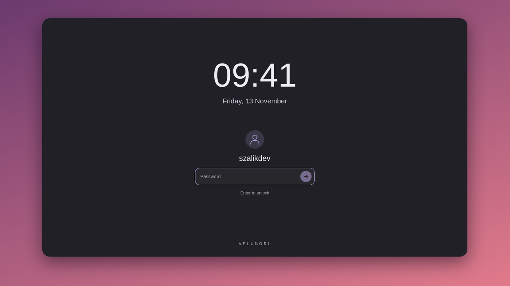

# Velunori Lock Screen

> Serene: a centered clock, date and quiet password field over your current wallpaper.



## Features

- A geometrically centered unlock arrow and the unchanged Omarchy 4.5 authentication service; video backgrounds use the host-generated poster in the Serene presentation.

- A centered clock and localized date, account name, subtle user icon and compact password field.
- Your current Omarchy wallpaper with blur and dimming; the accent follows Velunori Appearance.
- Password entry with Enter or the arrow button, immediate masking, Escape / Ctrl+U to clear, and readable failure feedback. Long masked values shrink to fit.
- Fingerprint hints when Omarchy reports an enrolled sensor. Password and fingerprint authentication remain in Omarchy's unchanged lock service.
- The service keeps secure lock surfaces, multi-monitor synchronization, wake handling and the existing `omarchy system lock` / `lock` IPC routes.

## Requirements

[Velunori Library](https://github.com/Velunori/lib) API 1 (version 1.x), installed in the real sibling `lib/` directory. Works with the stock Omarchy bar; Floating Bars is optional. Developed against **Omarchy 4.0.6-1**.

## Install

Install the shared library first, then run from this repository directory:

Run from an unlocked desktop terminal:

```bash
bash scripts/install-local.sh
```

The installer checks the unchanged service and PAM file, backs up `shell.json`, links the checkout, enables the `omarchy.lock` clone, restarts the shell and checks that the service has PAM configured. A verification failure restores the backup. It does not lock the desktop.

Preview the real wallpaper without locking or accepting a password:

```bash
omarchy-shell lock preview
```

Click the preview to dismiss it, or run `omarchy-shell lock hidePreview`. When ready to check actual unlocking, use the usual `omarchy system lock` command.

Restore the built-in lock screen from an unlocked desktop:

```bash
bash ~/dev/Velunori/lockscreen/scripts/restore-local.sh
```

## Development

```bash
bash scripts/check.sh
VELUNORI_TEST_LAYOUT=symlink VELUNORI_TEST_WIDTH=640 VELUNORI_TEST_HEIGHT=360 bash scripts/check.sh
```

The check refuses drift from Omarchy's authentication service, validates the clone manifest, lints the view and tests it in a regular offscreen window. Tests use fake input and only the view's signals: they never instantiate PAM or WlSessionLock and never lock/unlock the desktop. They cover synchronization, Enter submission, clearing, busy/disabled states, fingerprint visibility, long passwords and compact geometry.

Render a preview:

```bash
VELUNORI_PREVIEW_PATH=/tmp/lockscreen.png bash scripts/check.sh
```

`VELUNORI_PREVIEW_BACKGROUND=/absolute/path/to/image.png` supplies a wallpaper for a rendered preview. Compose repository artwork with `lib/scripts/compose-preview.sh`.

## Limits

Real password/fingerprint authentication, multi-monitor locking, display sleep/wake and GPU wallpaper blur still need desktop testing. Offscreen view tests do not prove secure session locking. Authentication is delegated to the stock Omarchy service; this project does not provide its own PAM configuration or an alternative unlock path. After Omarchy updates, merge any service changes before installing the clone again; `check.sh` and the installer detect service drift.

## Velunori plugins

Velunori is a set of independent plugins for the [Omarchy](https://omarchy.org) shell. Install only the ones you want; each lives in its own repository and can be removed without touching the others.

| Plugin | What it is |
| --- | --- |
| [bar](https://github.com/Velunori/bar) | The Island and Orbit bars, the appearance settings and the shared design kit |
| [clock](https://github.com/velunori/clock) | Clock in the bar with a month calendar |
| [control-center](https://github.com/velunori/control-center) | Sound, displays, network, capture and reminders in one panel |
| [notifications](https://github.com/velunori/notifications) | Notification cards and a session history |
| [menu](https://github.com/velunori/menu) | The Omarchy command menu as a two-pane panel |
| [update](https://github.com/velunori/update) | A window for `omarchy update` with release notes and live progress |
| [weather](https://github.com/velunori/weather) | Weather in the bar with a forecast panel |
| **lockscreen** (this repository) | Serene lock screen using Omarchy's session lock and authentication |

## License

MIT, see [LICENSE](LICENSE). Omarchy service/input behavior attribution is in [THIRD_PARTY_NOTICES.md](THIRD_PARTY_NOTICES.md).
